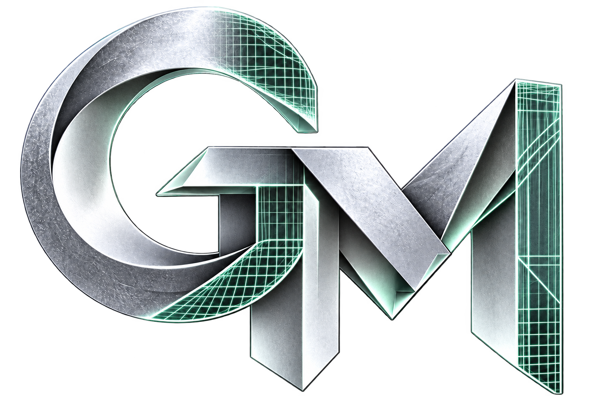

# Giovani Manzatto · Portfólio

**Ideias em código. Experiências na tela.**

Portfólio pessoal em React, com identidade visual própria e uma apresentação guiada pela rolagem.

**Em desenvolvimento**

---

## Sobre o projeto

Este repositório reúne a construção do meu portfólio como desenvolvedor front-end. A proposta é apresentar minha identidade, minhas tecnologias e meus projetos em uma experiência que combine clareza, criatividade e interação.

A implementação atual concentra-se no cabeçalho e na seção de abertura: uma composição de tipografia ampla, fundo escuro e destaques em verde-sálvia, com mensagens que acompanham o avanço da rolagem.

## Experiência implementada

- **Abertura guiada pelo scroll:** a seção hero permanece fixada durante um trecho da rolagem com o recurso `pin` do GSAP ScrollTrigger.
- **Quatro momentos de apresentação:** títulos e descrições mudam conforme o progresso da rolagem, conectando o ScrollTrigger ao estado do React.
- **Cabeçalho dinâmico:** após 300 pixels de rolagem, o cabeçalho recebe outro fundo e alterna a versão do logotipo.
- **Microinterações na navegação:** links com transições de cor e sublinhado animado em CSS.
- **Identidade visual centralizada:** cores definidas em variáveis CSS e imagens locais em WebP.

> A navegação já apresenta links para Início, Sobre, Tecnologias, Projetos e Contato. As seções além da abertura e a ligação completa das âncoras ainda serão implementadas.

## Tecnologias

| Tecnologia | Aplicação no projeto |
| --- | --- |
| React | Componentes, estado e gerenciamento do evento de rolagem com hooks |
| JavaScript | Lógica de interação e seleção do conteúdo exibido |
| GSAP + ScrollTrigger | Fixação da hero e acompanhamento do progresso da rolagem |
| @gsap/react | Integração do GSAP com os componentes React por meio de `useGSAP` |
| CSS | Layout, gradientes, variáveis de cor e transições |
| Vite | Ambiente de desenvolvimento e geração do build |
| ESLint | Configuração de análise estática do código |

## Organização do código

| Caminho | Responsabilidade |
| --- | --- |
| `src/App.jsx` | Composição do cabeçalho e da hero |
| `src/page/Header/` | Cabeçalho, logotipo e navegação |
| `src/page/hero/hero.jsx` | Estrutura da seção de abertura |
| `src/page/hero/informacao.jsx` | Mensagens e integração com o ScrollTrigger |
| `src/assets/css/` | Estilos do cabeçalho e da hero |
| `src/assets/img/` | Logotipos, ícones e imagens em WebP |
| `src/index.css` | Reset e paleta global |

## Evolução do portfólio

- [x] Estrutura inicial com React e Vite.
- [x] Identidade visual com paleta própria.
- [x] Cabeçalho com alteração visual durante a rolagem.
- [x] Hero fixada com troca de mensagens pelo scroll.
- [ ] Construir as seções Sobre, Tecnologias, Projetos e Contato.
- [ ] Conectar a navegação às seções.
- [ ] Adaptar e validar a experiência em telas menores.
- [ ] Refinar acessibilidade e comportamento com movimento reduzido.
- [ ] Remover os marcadores de depuração do ScrollTrigger antes da publicação.

## Scripts disponíveis

| Comando | Finalidade |
| --- | --- |
| `npm run dev` | Iniciar o servidor de desenvolvimento |
| `npm run build` | Gerar a versão de produção |
| `npm run preview` | Visualizar o build localmente |
| `npm run lint` | Executar a análise do ESLint |

## Autor

Desenvolvido por **Giovani Manzatto**.

[Conheça meus outros projetos no GitHub](https://github.com/gmanzattodev)

## Licença

Este projeto está sob a [licença MIT](./LICENSE).

---

Curiosidade move. Código transforma.

