<div align="center">

# Giovani Manzatto · Portfólio

**Desenvolvimento front-end, interfaces interativas e projetos autorais.**

[**Abrir o portfólio**](https://gmanzattodev.github.io/Portfolio/) · [Perfil no GitHub](https://github.com/gmanzattodev)

[](https://react.dev/)
[](https://developer.mozilla.org/pt-BR/docs/Web/JavaScript)
[](https://vite.dev/)
[](https://gsap.com/)

[Entrada](#entrada) · [Portfólio profissional](#portfólio-profissional) · [Portfólio interativo Minecraft](#portfólio-interativo-minecraft) · [Receitas](#guia-de-receitas) · [Rodar localmente](#rodar-localmente)

</div>

---

## Entrada

A tela inicial apresenta quem sou, as tecnologias que uso e dois caminhos para conhecer meu trabalho. Escolha a versão profissional para consultar projetos e habilidades ou entre no modo interativo para descobrir projetos na bancada.

<table>
  <tr>
    <th width="50%">Portfólio profissional</th>
    <th width="50%">Portfólio interativo</th>
  </tr>
  <tr>
    <td align="center"><a href="#portfólio-profissional">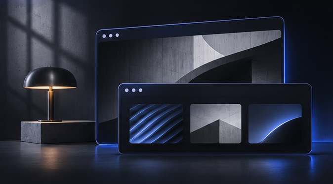</a></td>
    <td align="center"><a href="#portfólio-interativo-minecraft">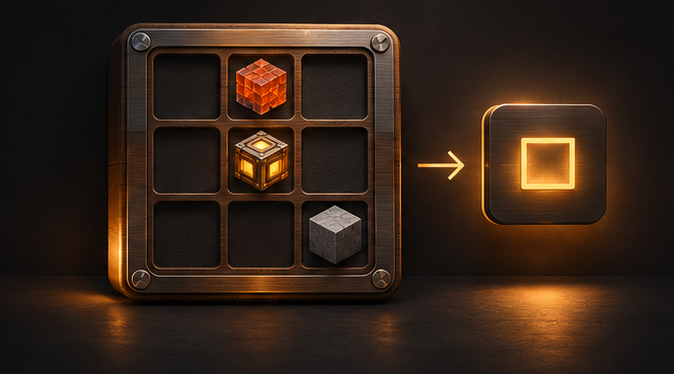</a></td>
  </tr>
</table>

## Portfólio profissional

Uma apresentação direta do meu trabalho como desenvolvedor front-end em formação. A navegação leva às seções **Início**, **Sobre**, **Tecnologias**, **Projetos** e **Contato**. A seção de tecnologias reúne HTML, CSS, JavaScript, React, GSAP e Git com barras que representam meu progresso nos estudos.

| Projeto em destaque | O que você encontra |
| --- | --- |
| [Site do estúdio](https://gmanzattodev.github.io/Mariliamanzattofurlan/) | Portfólio de fotografia com agendamento pelo WhatsApp. |
| [GM OS 2.0](https://github.com/gmanzattodev/GMOS-2.0) | Uma área de trabalho no navegador com dock e janelas. |
| **Kombi OS** | Interface multimídia de um projeto automotivo. |

## Portfólio interativo Minecraft

Uma experiência web inspirada em Minecraft. Clique nos ícones da hotbar ou use as teclas `1` para **Início**, `2` para **Sobre** e `3` para **Projetos**. Procure os três blocos de grama na abertura, adicione uma história à estante e combine itens para revelar projetos.

### Como usar a bancada

1. Vá até **Projetos**, clique em **Explorar projetos** e, depois, no livro que aparece.
2. Na bancada, selecione **Descobrir sites**. Abra a aba **Aplicações** e clique em um projeto para preencher a grade com a receita.
3. Para montar uma receita à mão, selecione um ingrediente no catálogo e clique no espaço desejado. No computador, use o botão direito sobre um espaço para esvaziá-lo.
4. Quando os nove espaços coincidirem com a receita, o ícone aparece no quadrado à direita. Clique nele para abrir o destino quando houver um link configurado.

### Guia de receitas

As **16 combinações** abaixo reproduzem o arquivo [`combinacoes.js`](./src/data/combinacoes.js). A bancada tem **3 × 3 espaços**. Leia cada linha da esquerda para a direita e deixe os espaços vazios como aparecem na imagem. Clique em um cartão para ampliá-lo.

<table>
  <tr>
    <td align="center" width="50%"><a href="./docs/receitas/esportcars.png">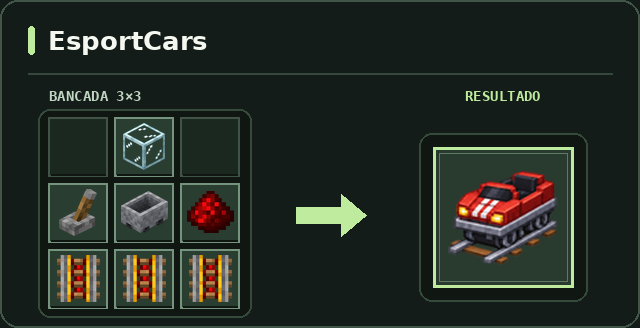</a></td>
    <td align="center" width="50%"><a href="./docs/receitas/agro.png">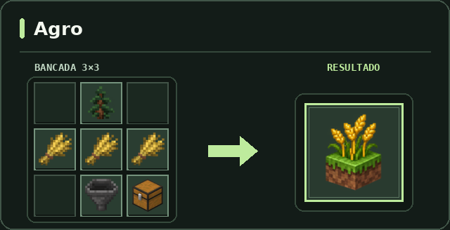</a></td>
  </tr>
  <tr>
    <td align="center" width="50%"><a href="./docs/receitas/gmos.png">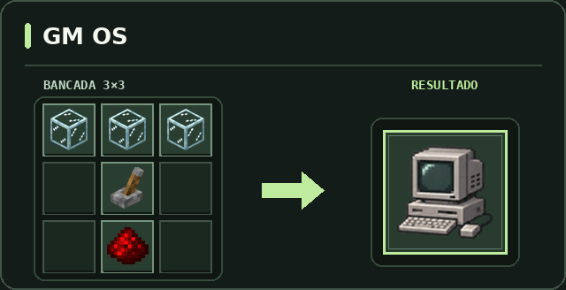</a></td>
    <td align="center" width="50%"><a href="./docs/receitas/gmos-2.png">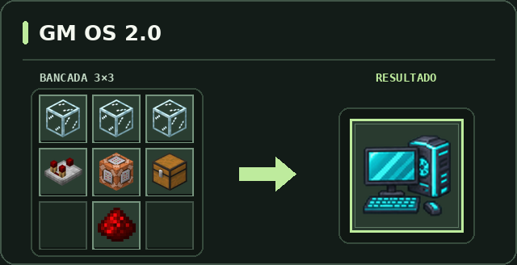</a></td>
  </tr>
  <tr>
    <td align="center" width="50%"><a href="./docs/receitas/minetec.png">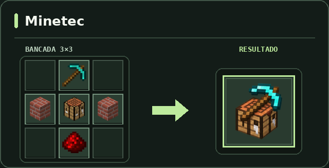</a></td>
    <td align="center" width="50%"><a href="./docs/receitas/portfolio.png">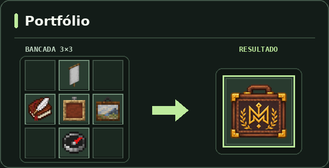</a></td>
  </tr>
  <tr>
    <td align="center" width="50%"><a href="./docs/receitas/marilia.png">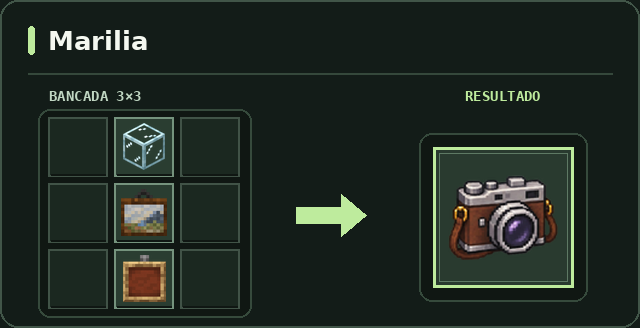</a></td>
    <td align="center" width="50%"><a href="./docs/receitas/marilia-manzatto-furlan.png">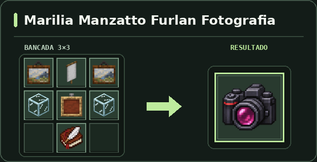</a></td>
  </tr>
  <tr>
    <td align="center" width="50%"><a href="./docs/receitas/natal.png">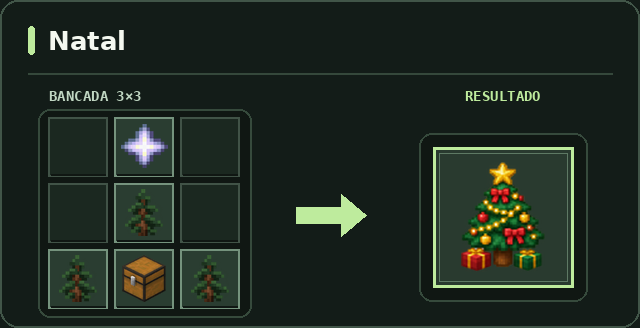</a></td>
    <td align="center" width="50%"><a href="./docs/receitas/bio.png">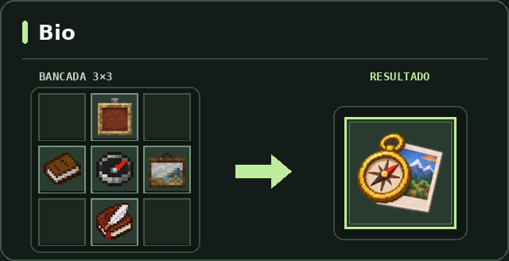</a></td>
  </tr>
  <tr>
    <td align="center" width="50%"><a href="./docs/receitas/projeto-linux.png">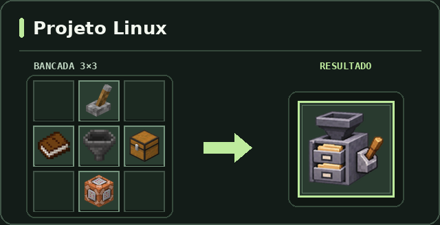</a></td>
    <td align="center" width="50%"><a href="./docs/receitas/linux.png">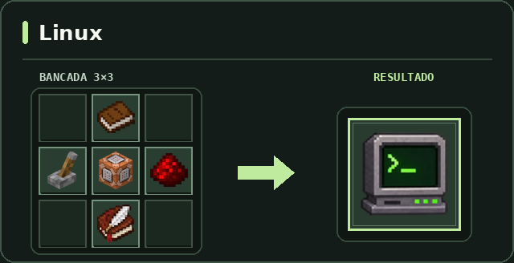</a></td>
  </tr>
  <tr>
    <td align="center" width="50%"><a href="./docs/receitas/javascript.png">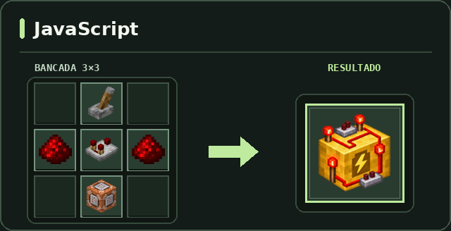</a></td>
    <td align="center" width="50%"><a href="./docs/receitas/html-e-css.png">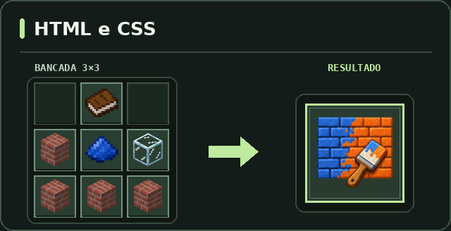</a></td>
  </tr>
  <tr>
    <td align="center" width="50%"><a href="./docs/receitas/gmanzattodev.png">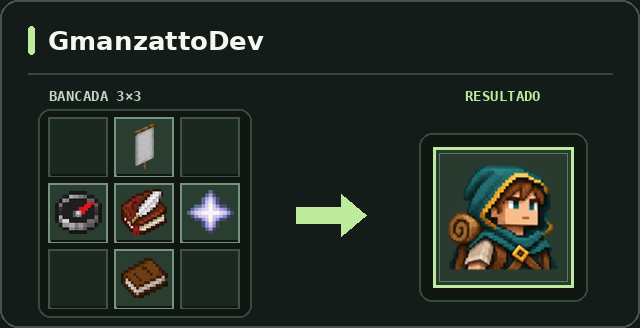</a></td>
    <td align="center" width="50%"><a href="./docs/receitas/contato.png">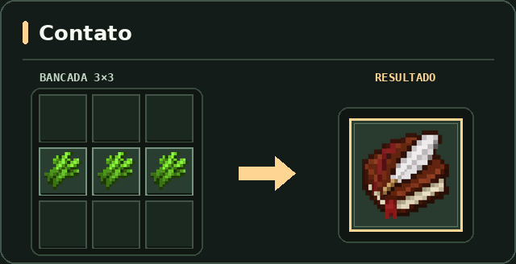</a></td>
  </tr>
</table>

> **Livro de contato.** Coloque três canas-de-açúcar na linha do meio. Clique no livro que aparece no resultado para equipá-lo e use o botão direito na tela para abrir suas páginas.

<details>
<summary>Consultar ingredientes e posições em texto</summary>

Cada coluna mostra uma linha da bancada, da esquerda para a direita. O símbolo `—` representa um espaço vazio.

| Resultado | Linha de cima | Linha do meio | Linha de baixo |
| --- | --- | --- | --- |
| [EsportCars](https://gmanzattodev.github.io/EsportCars/) | — · Vidro · — | Alavanca · Carrinho-de-mina · Redstone | Trilho elétrico · Trilho elétrico · Trilho elétrico |
| [Agro](https://gmanzattodev.github.io/agro/) | — · Muda de pinheiro · — | Trigo · Trigo · Trigo | — · Funil · Baú |
| [GM OS](https://github.com/gmanzattodev/GMOS) | Vidro · Vidro · Vidro | — · Alavanca · — | — · Redstone · — |
| [GM OS 2.0](https://gmanzattodev.github.io/GMOS-2.0/) | Vidro · Vidro · Vidro | Comparador de redstone · Bloco de comando · Baú | — · Redstone · — |
| [Minetec](https://gmanzattodev.github.io/MINETEC/) | — · Picareta de diamante · — | Bloco de tijolos · Bancada de trabalho · Bloco de tijolos | — · Redstone · — |
| Portfólio | — · Estandarte · — | Livro e pena · Moldura · Pintura | — · Bússola · — |
| [Marilia](https://gmanzattodev.github.io/Marilia/) | — · Vidro · — | — · Pintura · — | — · Moldura · — |
| [Marilia Manzatto Furlan Fotografia](https://gmanzattodev.github.io/Mariliamanzattofurlan/) | Pintura · Estandarte · Pintura | Vidro · Moldura · Vidro | — · Livro e pena · — |
| [Natal](https://gmanzattodev.github.io/Natal/) | — · Estrela do Nether · — | — · Muda de pinheiro · — | Muda de pinheiro · Baú · Muda de pinheiro |
| [Bio](https://gmanzattodev.github.io/bio/) | — · Moldura · — | Livro · Bússola · Pintura | — · Livro e pena · — |
| [Projeto Linux](https://github.com/gmanzattodev/projetoLinux) | — · Alavanca · — | Livro · Funil · Baú | — · Bloco de comando · — |
| [Linux](https://github.com/gmanzattodev/Linux) | — · Livro · — | Alavanca · Bloco de comando · Redstone | — · Livro e pena · — |
| [JavaScript](https://github.com/gmanzattodev/javascript) | — · Alavanca · — | Redstone · Comparador de redstone · Redstone | — · Bloco de comando · — |
| [HTML e CSS](https://github.com/gmanzattodev/html-e-css) | — · Livro · — | Bloco de tijolos · Corante azul · Vidro | Bloco de tijolos · Bloco de tijolos · Bloco de tijolos |
| [GmanzattoDev](https://github.com/gmanzattodev/GmanzattoDev) | — · Estandarte · — | Bússola · Livro e pena · Estrela do Nether | — · Livro · — |
| Contato | — · — · — | Cana-de-açúcar · Cana-de-açúcar · Cana-de-açúcar | — · — · — |

</details>

---

## Rodar localmente

Com uma versão LTS do Node.js e o npm instalados, execute os comandos abaixo e abra o endereço exibido no terminal.

```bash
git clone https://github.com/gmanzattodev/Portfolio.git
cd Portfolio
npm ci
npm run dev
```

| Comando | Função |
| --- | --- |
| `npm run build` | Gera o build de produção em `dist/`. |
| `npm run preview` | Abre uma prévia local do build. |
| `npm run lint` | Executa o ESLint. |

A publicação no GitHub Pages é feita pelo [workflow do repositório](./.github/workflows/deploy.yml).

## Código

| Caminho | Responsabilidade |
| --- | --- |
| [`src/App.jsx`](./src/App.jsx) | Exibe a entrada ou a experiência escolhida pelo visitante. |
| [`src/React-components/EntradaPortfólio/`](./src/React-components/EntradaPortf%C3%B3lio/) | Tela inicial e seleção da experiência. |
| [`src/page/Profissional/`](./src/page/Profissional/) | Seções e navegação da versão profissional. |
| [`src/React-components/CraftTable/`](./src/React-components/CraftTable/) | Catálogo, interação com os espaços e exibição do resultado. |
| [`src/data/combinacoes.js`](./src/data/combinacoes.js) e [`src/data/receitas.js`](./src/data/receitas.js) | Padrões da bancada, ingredientes e ícones. |

Desenvolvido por **[Giovani Manzatto](https://github.com/gmanzattodev)** · [Licença MIT](./LICENSE)
